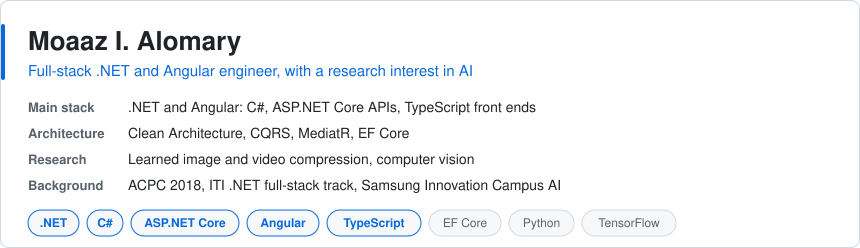
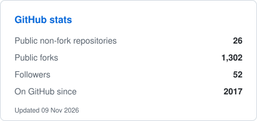
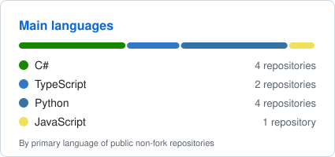
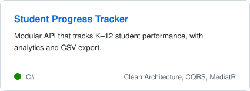
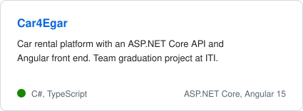
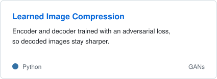
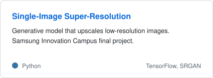

<picture><source media="(prefers-color-scheme: dark)" srcset="assets/cards/summary-dark.svg"></picture>

<picture><source media="(prefers-color-scheme: dark)" srcset="assets/cards/stats-dark.svg"></picture> <picture><source media="(prefers-color-scheme: dark)" srcset="assets/cards/languages-dark.svg"></picture>

Contact: [moaz.alomary98@gmail.com](mailto:moaz.alomary98@gmail.com)

## Selected work

<a href="https://github.com/edmontdants/Student-Progress-Tracker-Challenge-Solution"><picture><source media="(prefers-color-scheme: dark)" srcset="assets/cards/student-progress-dark.svg"></picture></a> <a href="https://github.com/edmontdants/Car4Egar"><picture><source media="(prefers-color-scheme: dark)" srcset="assets/cards/car4egar-dark.svg"></picture></a>

<a href="https://github.com/edmontdants/learned-image-compression-using-gan"><picture><source media="(prefers-color-scheme: dark)" srcset="assets/cards/image-compression-dark.svg"></picture></a> <a href="https://github.com/edmontdants/Single-Image-Super-Resolution-Using-a-Generative-Adversarial-Network-SRGANs"><picture><source media="(prefers-color-scheme: dark)" srcset="assets/cards/srgan-dark.svg"></picture></a>

Car4Egar source: [ASP.NET Core API](https://github.com/edmontdants/Car4Egar) and [Angular front end](https://github.com/edmontdants/Car4Egar-Angular)

## Research interests

End-to-end learned image and video encoding, and computer vision.

Implementations by other authors that I follow, kept as forks:

- [High-Fidelity Generative Image Compression](https://github.com/edmontdants/high-fidelity-generative-compression), by Justin-Tan
- [Full Resolution Image Compression with RNNs](https://github.com/edmontdants/pytorch-image-comp-rnn), by 1zb
- [BlockCNN](https://github.com/edmontdants/BlockCNN), for artifact removal and image compression, by DaniMlk
