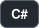
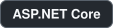
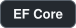
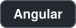
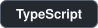
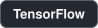

# Moaaz I. Alomary

**Backend engineer building .NET services, with a research interest in learned image compression and computer vision.**

[moaz.alomary98@gmail.com](mailto:moaz.alomary98@gmail.com)

## About

I build backend services in C# and ASP.NET Core, with a focus on Clean Architecture and CQRS. I also study how deep learning can compress and restore images.

My background includes competitive programming at ACPC 2018, the .NET full-stack track at ITI, and the AI course at Samsung Innovation Campus.

## Tech stack

  
  
  
  
  
  
  

## Selected work

### Backend and web

| Project | What it does | Built with |
| --- | --- | --- |
| [Student Progress Tracker](https://github.com/edmontdants/Student-Progress-Tracker-Challenge-Solution) | Modular API that tracks K–12 student performance, with analytics and CSV export | C#, Clean Architecture, CQRS, MediatR, EF Core |
| Car4Egar ([API](https://github.com/edmontdants/Car4Egar), [front end](https://github.com/edmontdants/Car4Egar-Angular)) | Car rental platform, built as a team graduation project at ITI | ASP.NET Core, Angular 15, TypeScript |
| [Simple Tab Organizer](https://github.com/edmontdants/Simple-Tab-Organizer-Chrome-Extension) | Chrome extension for organizing browser tabs, written for my own use | JavaScript |

### AI and computer vision

| Project | What it does | Built with |
| --- | --- | --- |
| [Learned image compression with GANs](https://github.com/edmontdants/learned-image-compression-using-gan) | Encoder and decoder trained with an adversarial loss, so decoded images stay sharper than with pixel loss alone | Python |
| [Single-image super-resolution (SRGAN)](https://github.com/edmontdants/Single-Image-Super-Resolution-Using-a-Generative-Adversarial-Network-SRGANs) | Generative model that upscales low-resolution images, built as my Samsung Innovation Campus final project | Python, TensorFlow |

## Research interests

End-to-end learned image and video encoding, and computer vision.

Implementations by other authors that I follow, kept as forks:

- [High-Fidelity Generative Image Compression](https://github.com/edmontdants/high-fidelity-generative-compression), by Justin-Tan
- [Full Resolution Image Compression with RNNs](https://github.com/edmontdants/pytorch-image-comp-rnn), by 1zb
- [BlockCNN](https://github.com/edmontdants/BlockCNN), for artifact removal and image compression, by DaniMlk
